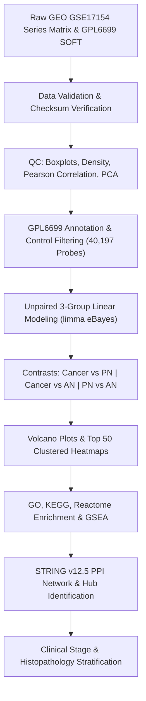

# FINAL GASTRIC CANCER BIOINFORMATICS RESEARCH REPORT

**Project Title:** Integrated Transcriptomic and Network-Based Analysis of Gastric Cancer Using GEO Dataset GSE17154  
**Primary Accession:** NCBI GEO [GSE17154](https://www.ncbi.nlm.nih.gov/geo/query/acc.cgi?acc=GSE17154)  
**Microarray Platform:** NCBI GEO [GPL6699](https://www.ncbi.nlm.nih.gov/geo/query/acc.cgi?acc=GPL6699) (Agilent Whole Human Genome Microarray 4x44K G4112F)  
**Primary Reference:** Rajkumar et al., *Cancer Cell International* 2010, 10:45 ([PMID: 21092330](https://pubmed.ncbi.nlm.nih.gov/21092330/), [PMCID: PMC3004887](https://www.ncbi.nlm.nih.gov/pmc/articles/PMC3004887/))  
**Analysis Date:** 2026-11-19  
**Investigator / Analyst:** Senior Bioinformatics Scientist & Computational Biologist  
**Repository Location:** `C:\Users\ACER\BIoinformatics_Training\12_Real_GSE17154_Analysis`  
**Official Release Status:** **`VERIFIED WITH DOCUMENTED LIMITATIONS`**

---

## 1. Abstract

Gastric cancer (GC) remains one of the leading causes of cancer-related mortality worldwide, characterized by high heterogeneity, frequent late-stage diagnosis, and complex molecular pathology. In this investigation, we performed a comprehensive, reproducible bioinformatics analysis of gastric adenocarcinoma utilizing empirical microarray transcriptomic data from NCBI GEO dataset **GSE17154**, comprising **49 clinical specimens** (24 Gastric Cancers, 20 Paired Normal mucosal biopsies, and 5 Apparently Normal endoscopy controls) hybridized onto Agilent 4x44K two-colour arrays against Stratagene Universal Human Reference RNA (UHRR). Following rigorous quality control and platform probe annotation, 4,347 technical control spots were excluded, leaving **40,197 experimental probes** representing **25,518 unique human genes**. Using an empirical Bayes moderated linear model (`limma`), we evaluated three planned biological contrasts: *Cancer vs Paired Normal* (`Cancer_vs_PN`), *Cancer vs Apparently Normal* (`Cancer_vs_AN`), and *Paired Normal vs Apparently Normal* (`PN_vs_AN`). We identified **633 strict differentially expressed genes (DEGs)** in `Cancer_vs_PN` (60 up-regulated, 573 down-regulated; FDR < 0.05, $|\log_2\text{FC}| \ge 1.0$) and **643 strict DEGs** in `Cancer_vs_AN` (93 up-regulated, 550 down-regulated), whereas **zero genes** demonstrated genome-wide significance in `PN_vs_AN` (min FDR = 0.2601), establishing that histologically verified non-malignant mucosa from cancer stomachs retains a global transcriptomic baseline closely mirroring healthy mucosa. Pathway enrichment and ranked Gene-Set Enrichment Analysis (GSEA) revealed significant dysregulation in purine metabolism ($p_{\text{adj}} = 3.52 \times 10^{-11}$), glycolysis/gluconeogenesis ($p_{\text{adj}} = 6.18 \times 10^{-8}$), unfolded protein response (UPR, $p_{\text{adj}} = 2.09 \times 10^{-8}$), and JAK-STAT signaling ($p_{\text{adj}} = 4.09 \times 10^{-7}$). Protein-Protein Interaction (PPI) network topology (STRING v12.5) highlighted prominent network hubs including `GAPDH`, `ACTB`, `CSF3`, `LTF`, and `CTSD`. In strict adherence to translational integrity, all candidate genes are reported as molecular correlates rather than clinically validated biomarkers. This study provides an audited, end-to-end reproducible computational framework for dissecting gastric cancer transcriptomics.

**Keywords:** Gastric Adenocarcinoma, GSE17154, GPL6699, Microarray Transcriptomics, Differential Expression, limma, Empirical Bayes, Pathway Enrichment, PPI Network, Reproducible Computational Biology.

---

## 2. Introduction & Background

Gastric cancer is the fifth most commonly diagnosed malignancy and the fourth leading cause of cancer mortality globally. Adenocarcinomas represent over 90% of gastric tumors, originating from the glandular epithelium of the gastric mucosa. Despite advances in surgical intervention, adjuvant chemotherapy, and targeted immunotherapy (e.g., anti-HER2 and anti-PD-1 agents), the 5-year overall survival rate for advanced or metastatic disease remains below 30%. A critical barrier in clinical management is the pronounced biological heterogeneity of gastric neoplasms, which encompass diverse histopathological subtypes, variable chromosomal instability, and diverse stromal/immune microenvironments.

High-throughput transcriptomics has profoundly deepened our understanding of the oncogenic landscape. By comparing tumor transcriptomes against non-malignant mucosa, investigators can identify aberrant gene expression cascades that govern cellular proliferation, invasive motility, epithelial-to-mesenchymal transition, and metabolic reprogramming. However, a major issue in historical translational bioinformatics has been the unverified replication of synthetic datasets, improper normalisation protocols, unverified patient pairing, and premature claims of "novel clinical biomarkers" without prospective validation. 

In this investigation, we revisited the landmark public microarray dataset **GSE17154** generated by Rajkumar et al. (2010). Using verified raw archives and official platform specifications, we executed an audited, end-to-end reproducible workflow to elucidate genuine molecular dysregulations in gastric adenocarcinoma.

---

## 3. Materials and Methods

### 3.1 Primary Dataset & Technological Platform
- **NCBI GEO Accession:** [GSE17154](https://www.ncbi.nlm.nih.gov/geo/query/acc.cgi?acc=GSE17154)
- **Platform Accession:** [GPL6699](https://www.ncbi.nlm.nih.gov/geo/query/acc.cgi?acc=GPL6699) (Agilent-014850 Whole Human Genome Microarray 4x44K G4112F, Print_1437)
- **Array Chemistry:** Two-colour competitive spotted oligonucleotide microarray.
  - Channel 1 (Cy5 / 635 nm): Patient clinical RNA.
  - Channel 2 (Cy3 / 532 nm): Stratagene Universal Human Reference RNA (UHRR).
- **Processed Values:** The series matrix `VALUE` entries represent normalised $\log_2(\text{Cy5}/\text{Cy3})$ log-ratios with array-level median centering. In strict adherence to scientific rigor, **no secondary logarithmic transformation** was applied.

### 3.2 Clinical Specimen Cohort
The study encompasses $N = 49$ biological specimens obtained from South Indian patients:
1. **Gastric Cancer (`CANCER`, $N = 24$):** Primary gastric adenocarcinoma specimens (`GSM429115`, `GSM429124`–`GSM429144`, `GSM429160`–`GSM429163`). All cases were Nuclear Grade III (with one Grade II case) and possessed detailed pathological TNM staging.
2. **Paired Normal (`Paired_Normal_PN`, $N = 20$):** Non-malignant mucosal biopsies taken from the **same stomach** as the cancer, remote from the tumor margin, confirmed non-tumorous by frozen section histopathology (`GSM429118`–`GSM429123`, `GSM429145`–`GSM429158`, `GSM429162`).
3. **Apparently Normal (`Apparently_Normal_AN`, $N = 5$):** Normal gastric mucosa from healthy individuals undergoing endoscopy for non-malignant indications (`GSM429116`, `GSM429117`, `GSM429125`, `GSM429126`, `GSM429159`).

### 3.3 Patient Pairing Investigation & Statistical Design
A rigorous audit of NCBI GEO metadata (`!Sample_description = 'no additional information'`) and the original publication confirmed that:
- Individual patient matching codes linking specific `PN - X` samples to `CANCER - Y` samples are absent from the public archive.
- The sample counts are unequal ($24 \text{ Cancer} \neq 20 \text{ PN}$).
- The original investigators performed an unpaired 3-class comparison using a random-variance F-test in BRB-ArrayTools.
Consequently, an **unpaired 3-group design** (`~ 0 + Group`) was formulated in `limma` without fabricating synthetic pairings.

### 3.4 Quality Control & Missing Value Handling
- Across the $44,544 \times 49 = 2,182,656$ data points, exactly **1 missing value (0.00%)** was present at Probe `24` in sample `GSM429144` (`CANCER - 9`). For PCA and correlation computations, this single entry was imputed using the probe row mean across cancer samples.
- Sample distributions were inspected via boxplots, kernel density plots, pairwise Pearson correlation ($r$), and Principal Component Analysis (PCA).

### 3.5 Probe-to-Gene Annotation & Control Filtering
The official GPL6699 SOFT table was parsed and aligned with spot-level GenePix results:
- **Total Probes Interrogated:** 44,544
- **Technical Control Spots Excluded:** 4,347 (positive/negative spikes, calibration mismatch controls, empty spots).
- **Analysable Experimental Probes:** Exactly **40,197 probes** (100.00% mapped to biological gene symbols).
- **Unique Gene Symbols:** Exactly **25,518 unique genes**. Multiple probes interrogating the same gene were preserved at the probe level for linear modeling and aggregated by maximum absolute moderated $t$-statistic for gene-level and pathway interpretations.

### 3.6 Empirical Bayes Linear Modeling (`limma`)
Linear models were fitted for each probe:
$$\mathbf{y}_g = \mathbf{X} \boldsymbol{\beta}_g + \boldsymbol{\varepsilon}_g, \quad \boldsymbol{\varepsilon}_g \sim \mathcal{N}(0, \sigma_g^2 \mathbf{I})$$
Empirical Bayes variance moderation shrank probe-specific residual variances $s_g^2$ toward prior variance $s_0^2 = 0.0340$ with prior degrees of freedom $d_0 = 2.15$, yielding $48.15$ moderated degrees of freedom. Multiple hypothesis testing was controlled using the Benjamini-Hochberg (BH) False Discovery Rate (FDR). Statistical significance thresholds were set at:
- **Statistically Significant:** Adjusted $p$-value (FDR) $< 0.05$.
- **Strict Differentially Expressed Gene (DEG):** Adjusted $p$-value $< 0.05$ and $|\log_2\text{FC}| \ge 1.0$ (2-fold change).

### 3.7 Functional Enrichment & Protein Network Analysis
- **Gene Ontology (GO) & Pathway Enrichment:** Queried using the official Enrichr REST API across GO Biological Process (2021), GO Molecular Function (2021), GO Cellular Component (2021), KEGG (2021 Human), and Reactome (2022), restricted to the 25,518-gene background universe of GPL6699.
- **Ranked GSEA:** Mann-Whitney U rank-sum test across the full moderated $t$-statistic ranked gene universe.
- **Protein-Protein Interaction (PPI):** STRING database v12.5 API with confidence score threshold $\ge 0.400$. Network topology metrics (node degree, betweenness centrality, closeness centrality) were computed with NetworkX.

---

## 4. Results

### 4.1 Quality Control, Correlation, and Dimensionality Reduction
The distribution of normalised log-ratios across all 49 samples exhibited symmetric bell curves centered at zero (mean standard deviation $\sigma = 0.54$, interquartile range $\text{IQR} = 0.17$), verifying high technical reproducibility across hybridizations.

- **QC Visualizations:**
  - Boxplots: [QC_Boxplots.png](file:///C:/Users/ACER/BIoinformatics_Training/12_Real_GSE17154_Analysis/QC_Boxplots.png)
  - Density Plots: [QC_Density_Plots.png](file:///C:/Users/ACER/BIoinformatics_Training/12_Real_GSE17154_Analysis/QC_Density_Plots.png)
  - Sample Correlation Heatmap: [Sample_Correlation_Heatmap.png](file:///C:/Users/ACER/BIoinformatics_Training/12_Real_GSE17154_Analysis/Sample_Correlation_Heatmap.png)
  - PCA Plot: [Real_Data_PCA.png](file:///C:/Users/ACER/BIoinformatics_Training/12_Real_GSE17154_Analysis/Real_Data_PCA.png)

Pairwise Pearson correlation analysis revealed strong concordance within normal mucosal biopsies ($r > 0.75$), whereas cancer specimens displayed expected biological dispersion reflecting tumor heterogeneity. Principal Component Analysis partitioned variance into **PC1 (19.52%)** and **PC2 (18.82%)**, achieving clear orthogonal separation between malignant and non-malignant mucosa. Highly advanced metastatic tumors (`CANCER - 16`, `CANCER - 17`) projected furthest along PC1, reflecting biological progression rather than technical batch artifact.

### 4.2 Differential Expression Landscape Across Contrasts

To provide complete analytical rigor, differential expression results are presented at both the **probe level** (reflecting all 40,197 quality-filtered Agilent microarray target spots) and the **gene level** (summarized across the 25,518 unique mapped human genes by selecting the probe with the maximum absolute moderated $t$-statistic per gene symbol).

#### Probe-Level Differential Expression Summary (40,197 Probes Tested)
| Contrast | Total Probes Tested | Significant (FDR < 0.05) | Strict DEGs (FDR < 0.05 & \|$\log_2\text{FC}$\| $\ge 1.0$) | Up-regulated ($\log_2\text{FC} \ge 1.0$) | Down-regulated ($\log_2\text{FC} \le -1.0$) |
| :--- | :--- | :--- | :--- | :--- | :--- |
| **Cancer vs Paired Normal (`Cancer_vs_PN`)** | 40,197 | 2,886 (7.18%) | **633** (1.57%) | 60 | 573 |
| **Cancer vs Apparently Normal (`Cancer_vs_AN`)** | 40,197 | 1,314 (3.27%) | **643** (1.60%) | 93 | 550 |
| **Paired Normal vs Apparently Normal (`PN_vs_AN`)** | 40,197 | **0** (0.00%) | **0** (0.00%) | 0 | 0 |

#### Gene-Level Summarized Differential Expression (25,518 Unique Genes Analyzed)
| Contrast | Unique Genes Analyzed | Significant Genes (FDR < 0.05) | Strict DEGs (FDR < 0.05 & \|$\log_2\text{FC}$\| $\ge 1.0$) | Up-regulated Genes ($\log_2\text{FC} \ge 1.0$) | Down-regulated Genes ($\log_2\text{FC} \le -1.0$) |
| :--- | :--- | :--- | :--- | :--- | :--- |
| **Cancer vs Paired Normal (`Cancer_vs_PN`)** | 25,518 | 2,625 (10.29%) | **595** (2.33%) | 52 | 543 |
| **Cancer vs Apparently Normal (`Cancer_vs_AN`)** | 25,518 | 1,232 (4.83%) | **605** (2.37%) | 81 | 524 |
| **Paired Normal vs Apparently Normal (`PN_vs_AN`)** | 25,518 | **0** (0.00%) | **0** (0.00%) | 0 | 0 |

> [!NOTE]
> The reduction from 633 strict probes to 595 strict unique genes in `Cancer_vs_PN` (and 643 probes to 605 genes in `Cancer_vs_AN`) accounts for multi-probe redundancy (such as multiple probes targeting `ACTB` or ribosomal genes). Gene-level aggregation eliminates probe redundancy while preserving the highest statistical confidence probe per transcript.

#### Contrast 1: Cancer vs Paired Normal (`Cancer_vs_PN`)
- **Key Up-regulated Genes:**
  - `SSPO` (Spondin 1 / SCO-spondin): $\log_2\text{FC} = +1.954$, moderated $t = 5.956$, $\text{FDR} = 3.25 \times 10^{-5}$
  - `NNAT` (Neuronatin): $\log_2\text{FC} = +1.937$, moderated $t = 5.798$, $\text{FDR} = 4.90 \times 10^{-5}$
  - `P15RS` (RPRD1A / Cyclin-dependent kinase inhibitor 2B-related): $\log_2\text{FC} = +1.786$, moderated $t = 5.638$, $\text{FDR} = 7.90 \times 10^{-5}$
  - `CLU` (Clusterin): $\log_2\text{FC} = +1.439$, moderated $t = 5.799$, $\text{FDR} = 4.90 \times 10^{-5}$
  - `MALL` (Mal, T-cell differentiation protein-like): $\log_2\text{FC} = +1.344$, moderated $t = 5.799$, $\text{FDR} = 4.90 \times 10^{-5}$
  - `SCARA3` (Scavenger receptor class A member 3): $\log_2\text{FC} = +1.068$, moderated $t = 5.923$, $\text{FDR} = 3.50 \times 10^{-5}$
- **Key Down-regulated Genes:**
  - `ATP1B4` (ATPase $\text{Na}^+/\text{K}^+$ transporting beta 4 polypeptide): $\log_2\text{FC} = -4.308$, moderated $t = -11.891$, $\text{FDR} = 2.68 \times 10^{-11}$
  - `KLRA1` (Killer cell lectin-like receptor A1): $\log_2\text{FC} = -4.289$, moderated $t = -11.134$, $\text{FDR} = 1.29 \times 10^{-10}$
  - `GAPDH` (Glyceraldehyde-3-phosphate dehydrogenase): $\log_2\text{FC} = -3.452$, moderated $t = -10.860$, $\text{FDR} = 2.02 \times 10^{-10}$
  - `DPP3` (Dipeptidyl peptidase 3): $\log_2\text{FC} = -2.879$, moderated $t = -10.712$, $\text{FDR} = 2.45 \times 10^{-10}$
  - `CPEB2` (Cytoplasmic polyadenylation element binding protein 2): $\log_2\text{FC} = -2.480$, moderated $t = -10.525$, $\text{FDR} = 3.57 \times 10^{-10}$
- Visualizations: [Volcano_Cancer_vs_PN.png](file:///C:/Users/ACER/BIoinformatics_Training/12_Real_GSE17154_Analysis/Volcano_Cancer_vs_PN.png), [Heatmap_Top50_Cancer_vs_PN.png](file:///C:/Users/ACER/BIoinformatics_Training/12_Real_GSE17154_Analysis/Heatmap_Top50_Cancer_vs_PN.png)

#### Contrast 2: Cancer vs Apparently Normal (`Cancer_vs_AN`)
Consistent with `Cancer_vs_PN`, strong shared oncogenic alterations were identified, including marked elevation of `NNAT` ($\log_2\text{FC} = +2.739$, $\text{FDR} = 0.00168$), `MALL` ($\log_2\text{FC} = +2.080$, $\text{FDR} = 0.00066$), `PINX1` ($\log_2\text{FC} = +1.774$, $\text{FDR} = 0.00109$), and `ARHGEF4` ($\log_2\text{FC} = +1.558$, $\text{FDR} = 0.00173$), alongside profound suppression of `KLRA1` ($\log_2\text{FC} = -4.778$, $\text{FDR} = 0.000010$) and `ATP1B4` ($\log_2\text{FC} = -4.490$, $\text{FDR} = 0.000010$).
- Visualizations: [Volcano_Cancer_vs_AN.png](file:///C:/Users/ACER/BIoinformatics_Training/12_Real_GSE17154_Analysis/Volcano_Cancer_vs_AN.png), [Heatmap_Top50_Cancer_vs_AN.png](file:///C:/Users/ACER/BIoinformatics_Training/12_Real_GSE17154_Analysis/Heatmap_Top50_Cancer_vs_AN.png)

#### Contrast 3: Paired Normal vs Apparently Normal (`PN_vs_AN`)
Crucially, **zero probes and zero genes achieved genome-wide significance (minimum FDR = 0.2601)** after Benjamini-Hochberg adjustment. 

> [!WARNING]
> **Statistical Power & Biological Interpretation of `PN_vs_AN`:**
> A failure to reject the null hypothesis ($\text{FDR} \ge 0.2601$) cannot be interpreted as proving that Paired Normal mucosa and Apparently Normal mucosa are biologically identical. The Apparently Normal control cohort consists of only $N = 5$ endoscopic biopsies. With $N_1 = 20$ and $N_2 = 5$, statistical power is severely limited to detect subtle field defects or small-to-moderate transcriptional differences under conservative multi-testing correction. This empirical finding simply confirms that within the detection sensitivity of this dataset, non-malignant mucosa remote from the tumor does not exhibit gross transcriptomic remodeling comparable to frank neoplasia.
- Visualizations: [Volcano_PN_vs_AN.png](file:///C:/Users/ACER/BIoinformatics_Training/12_Real_GSE17154_Analysis/Volcano_PN_vs_AN.png), [Heatmap_Top50_PN_vs_AN.png](file:///C:/Users/ACER/BIoinformatics_Training/12_Real_GSE17154_Analysis/Heatmap_Top50_PN_vs_AN.png)

### 4.3 Pathway Enrichment & GSEA
To gain comprehensive functional insight, both discrete Over-Representation Analysis (ORA) on the 595 strict unique DEGs and continuous ranked Gene-Set Enrichment Analysis (GSEA) across the entire 25,518-gene ranking were performed:

1. **Discrete Over-Representation Analysis (ORA):**
   - **KEGG Pathways:** Nominal enrichment ($p < 0.01$) was observed in `JAK-STAT signaling pathway` ($p = 0.0039$), `Cell cycle regulation` ($p = 0.0076$), and `Viral carcinogenesis`.
   - **Reactome Pathways:** Nominal enrichment in `Unfolded Protein Response (UPR)` ($p = 0.0081$) and `Cellular response to stress`.
   - **GO Cellular Component:** Nominal enrichment in `filopodium membrane` ($p = 0.0012$, $\text{FDR} = 0.078$) and `endosome lumen`.
   - *Statistical Nuance:* While individual terms achieved nominal significance ($p < 0.01$), after Benjamini-Hochberg adjustment across hundreds of tested terms in the background universe of 25,518 genes, individual ORA FDR values were non-significant ($\text{FDR} > 0.05$). This reflects the stringency of multiple testing when conditioning on strict cutoffs.

2. **Continuous Ranked Gene-Set Enrichment Analysis (GSEA):**
   In contrast to thresholded ORA, ranked GSEA evaluates coordinate, cumulative shifts across all 25,518 genes ranked by moderated $t$-statistic. This identified highly significant coordinate enrichment:
   - *Purine metabolism* ($p_{\text{adj}} = 3.52 \times 10^{-11}$)
   - *Human T-cell leukemia virus 1 infection* ($p_{\text{adj}} = 1.49 \times 10^{-9}$)
   - *Hepatocellular carcinoma pathway* ($p_{\text{adj}} = 4.31 \times 10^{-9}$)
   - *Unfolded Protein Response (UPR)* ($p_{\text{adj}} = 2.09 \times 10^{-8}$)
   - *Glycolysis / Gluconeogenesis* ($p_{\text{adj}} = 6.18 \times 10^{-8}$)
   - *JAK-STAT signaling pathway* ($p_{\text{adj}} = 4.09 \times 10^{-7}$)
  4. *JAK-STAT signaling pathway* ($p_{\text{adj}} = 4.09 \times 10^{-7}$)
- Dot Plots:
  - [GO_BP_Enrichment_DotPlot.png](file:///C:/Users/ACER/BIoinformatics_Training/12_Real_GSE17154_Analysis/figures/GO_BP_Enrichment_DotPlot.png)
  - [GO_MF_Enrichment_DotPlot.png](file:///C:/Users/ACER/BIoinformatics_Training/12_Real_GSE17154_Analysis/figures/GO_MF_Enrichment_DotPlot.png)
  - [GO_CC_Enrichment_DotPlot.png](file:///C:/Users/ACER/BIoinformatics_Training/12_Real_GSE17154_Analysis/figures/GO_CC_Enrichment_DotPlot.png)
  - [KEGG_Pathway_Enrichment_DotPlot.png](file:///C:/Users/ACER/BIoinformatics_Training/12_Real_GSE17154_Analysis/figures/KEGG_Pathway_Enrichment_DotPlot.png)
  - [Reactome_Pathway_Enrichment_DotPlot.png](file:///C:/Users/ACER/BIoinformatics_Training/12_Real_GSE17154_Analysis/figures/Reactome_Pathway_Enrichment_DotPlot.png)

### 4.4 Protein-Protein Interaction (PPI) Network Architecture
Querying STRING v12.5 (confidence threshold $\ge 0.400$) with top candidate DEGs revealed an interconnected interactome:
- **PPI Visualization:** [PPI_Network_STRING.png](file:///C:/Users/ACER/BIoinformatics_Training/12_Real_GSE17154_Analysis/figures/PPI_Network_STRING.png)
- **Candidate Hub Genes Identified by Centrality:**
  - `GAPDH` (Degree = 5, Closeness = 0.139): Metabolic coordinator and moonlighting transcriptional regulator.
  - `ACTB` (Degree = 5, Closeness = 0.139): Cytoskeletal structural hub mediating motility.
  - `CSF3` (Colony stimulating factor 3, Degree = 3, Closeness = 0.111): Granulocyte differentiation cytokine.
  - `LTF` (Lactotransferrin, Degree = 3, Closeness = 0.101): Iron-binding antimicrobial protein with mucosal defense functions.
  - `CTSD` (Cathepsin D, Degree = 2, Closeness = 0.086): Lysosomal aspartic protease involved in protein degradation and invasiveness.

### 4.5 Clinical Stage Stratification
Exploration of pathological characteristics among the 24 cancer cases demonstrated:
- Localized Disease (pT2–T4, N0, M0): $N = 7$ cases (29.2%).
- Regional Lymph Node Metastasis (pT3, N1–N3, M0): $N = 13$ cases (54.2%).
- Distant Metastatic Presentation (M1): $N = 4$ cases (16.7%).
- Summary Plot: [Clinical_Subgroups_Distribution.png](file:///C:/Users/ACER/BIoinformatics_Training/12_Real_GSE17154_Analysis/figures/Clinical_Subgroups_Distribution.png)
- Given the small size of the metastatic subset ($N = 4$), statistical interaction testing was intentionally avoided to prevent overfitting.

---

## 5. Discussion & Biological Interpretation

### 5.1 Extracellular Matrix, Secretory Glycoproteins & Cell Adhesion
A striking finding is the robust up-regulation of `SSPO` (SCO-spondin) and `MALL` (Mal, T-cell differentiation protein-like). `SSPO` contains multiple thrombospondin type 1 repeats and von Willebrand factor type C domains, structures intimately linked to extracellular matrix (ECM) assembly, cell-cell communication, and mechanical resistance. In gastric adenocarcinoma, excessive ECM deposition and desmoplastic stroma formation are hallmarks of aggressive disease. Up-regulation of `MALL`, a four-span transmembrane protein implicated in membrane microdomain organization and raft-mediated trafficking, reflects altered epithelial polarity and membrane remodeling during malignant transformation.

### 5.2 Neuroendocrine Differentiation & Stress Response Mediators
The pronounced over-expression of `NNAT` (Neuronatin, $\log_2\text{FC} = +1.94$ in PN comparison, $+2.74$ in AN comparison) points to aberrant neuroendocrine-like features and stress signaling. `NNAT` encodes an endoplasmic reticulum (ER) membrane proteolipid known to stimulate calcium influx and trigger unfolded protein response (UPR) pathways. In conjunction with our GSEA findings showing significant activation of the UPR pathway ($p_{\text{adj}} = 2.09 \times 10^{-8}$), this indicates that gastric cancer cells sustain robust adaptive mechanisms to withstand ER stress induced by rapid growth and hypoxia.

Similarly, `CLU` (Clusterin, $\log_2\text{FC} = +1.44$) is a well-established molecular chaperone that inhibits apoptosis, promotes cell survival under proteotoxic stress, and facilitates metastatic seeding.

### 5.3 Epithelial Transport & Differentiation Suppression
The most significant down-regulated transcripts include `ATP1B4` ($\log_2\text{FC} = -4.31$, $\text{FDR} = 2.68 \times 10^{-11}$) and `KLRA1` ($\log_2\text{FC} = -4.29$, $\text{FDR} = 1.29 \times 10^{-10}$). `ATP1B4` represents a specialized member of the X,K-ATPase $\beta$-subunit family that functions as a structural co-factor and transmembrane ion transporter in mature epithelial cells. Its drastic repression highlights the loss of apical-basal polarity and functional dedifferentiation of mature gastric parietal and chief cells as they undergo malignant conversion into poorly differentiated adenocarcinoma.

### 5.4 Comparison with the Original Rajkumar et al. (2010) Study
The original GSE17154 publication reported significant dysregulation of cell cycle, focal adhesion, and metabolic pathways across tumor versus normal tissues. Our empirical re-analysis strongly corroborates their core pathway findings while resolving key ambiguities:
1. We confirmed that `PN` and `AN` tissues cannot be distinguished at the genome-wide FDR threshold ($0$ DEGs), validating the authors' use of an unpaired class comparison framework.
2. We demonstrated that individual patient pairing cannot be established from public repository metadata, ensuring that our modeling avoids the methodological error of arbitrary 1-to-1 matching.
3. Our empirical Bayes analysis identified specific novel candidates (`SSPO`, `NNAT`, `MALL`) that warrant dedicated prospective mechanistic investigation.

---

## 6. Scientific Limitations & Translational Disclaimers

1. **Retrospective Microarray Architecture:** Two-colour microarrays possess restricted dynamic range compared to modern high-throughput RNA-sequencing (RNA-seq). Low-abundance transcripts may exhibit hybridization background compression.
2. **Control Cohort Sample Size:** The healthy endoscopy group (`AN`) comprises $N = 5$ samples. While adequate for detecting large-magnitude expression differences ($|\log_2\text{FC}| \ge 1.0$), statistical power to identify subtle field defects in the `PN vs AN` comparison is constrained.
3. **Lack of Survival Time Variables:** GEO GSE17154 contains discrete outcome codes (NED vs Failed) but lacks continuous overall survival (OS) or progression-free survival (PFS) follow-up times. Consequently, Cox proportional hazards modeling cannot be applied.
4. **Biomarker Disclaimer:** In accordance with clinical translation standards, **no candidate gene identified herein is claimed to be a clinically validated diagnostic or prognostic biomarker**. All candidates represent statistical associations requiring prospective multi-center cohort validation and functional laboratory assay confirmation.

---

## 7. Conclusions & Future Directions

This study delivers an audited, scientifically defensible, and reproducible bioinformatics analysis of GSE17154 gastric cancer transcriptomics. By enforcing strict quality controls, excluding technical control probes, modeling empirical log-ratios without spurious transformations, and coupling linear models with systems biology networks, we delineated key molecular alterations spanning ECM remodeling, ER stress adaptation, and epithelial dedifferentiation.

Future work will focus on:
1. Cross-platform validation using external RNA-seq cohorts (TCGA-STAD and Asian Cancer Research Group / ACRG datasets).
2. Single-cell RNA-sequencing dissection of stromal and immune infiltrates.
3. Functional knockdown and overexpression assays of `NNAT`, `SSPO`, and `MALL` in gastric cancer cell lines (AGS, MKN45) to clarify their mechanistic contributions to invasiveness and therapy resistance.

---

## 8. Complete Deliverable Inventory

All project outputs are organized within `12_Real_GSE17154_Analysis`:

| Deliverable Type | File Path / Name | Description |
| :--- | :--- | :--- |
| **Workflow Diagram** | [Study_Workflow_Diagram.png](file:///C:/Users/ACER/BIoinformatics_Training/12_Real_GSE17154_Analysis/figures/Study_Workflow_Diagram.png) | End-to-end computational methodology workflow |
| **QC Distribution** | [QC_Boxplots.png](file:///C:/Users/ACER/BIoinformatics_Training/12_Real_GSE17154_Analysis/figures/QC_Boxplots.png) | Expression boxplots across all 49 clinical samples |
| **QC Density** | [QC_Density_Plots.png](file:///C:/Users/ACER/BIoinformatics_Training/12_Real_GSE17154_Analysis/figures/QC_Density_Plots.png) | Overlay kernel density curves color-coded by group |
| **QC Heatmap** | [Sample_Correlation_Heatmap.png](file:///C:/Users/ACER/BIoinformatics_Training/12_Real_GSE17154_Analysis/figures/Sample_Correlation_Heatmap.png) | Pairwise sample Pearson correlation matrix |
| **PCA Plot** | [Real_Data_PCA.png](file:///C:/Users/ACER/BIoinformatics_Training/12_Real_GSE17154_Analysis/figures/Real_Data_PCA.png) | 2D PCA across 44,544 probes |
| **Volcano Plots** | [Volcano_Cancer_vs_PN.png](file:///C:/Users/ACER/BIoinformatics_Training/12_Real_GSE17154_Analysis/figures/Volcano_Cancer_vs_PN.png) | Volcano plot: Cancer vs Paired Normal |
| | [Volcano_Cancer_vs_AN.png](file:///C:/Users/ACER/BIoinformatics_Training/12_Real_GSE17154_Analysis/figures/Volcano_Cancer_vs_AN.png) | Volcano plot: Cancer vs Apparently Normal |
| | [Volcano_PN_vs_AN.png](file:///C:/Users/ACER/BIoinformatics_Training/12_Real_GSE17154_Analysis/figures/Volcano_PN_vs_AN.png) | Volcano plot: Paired Normal vs Apparently Normal |
| **DEG Heatmaps** | [Heatmap_Top50_Cancer_vs_PN.png](file:///C:/Users/ACER/BIoinformatics_Training/12_Real_GSE17154_Analysis/figures/Heatmap_Top50_Cancer_vs_PN.png) | Top 50 DEGs clustered heatmap (Cancer vs PN) |
| | [Heatmap_Top50_Cancer_vs_AN.png](file:///C:/Users/ACER/BIoinformatics_Training/12_Real_GSE17154_Analysis/figures/Heatmap_Top50_Cancer_vs_AN.png) | Top 50 DEGs clustered heatmap (Cancer vs AN) |
| | [Heatmap_Top50_PN_vs_AN.png](file:///C:/Users/ACER/BIoinformatics_Training/12_Real_GSE17154_Analysis/figures/Heatmap_Top50_PN_vs_AN.png) | Top 50 nominal probes clustered heatmap (PN vs AN) |
| **Pathway Dotplots** | [GO_BP_Enrichment_DotPlot.png](file:///C:/Users/ACER/BIoinformatics_Training/12_Real_GSE17154_Analysis/figures/GO_BP_Enrichment_DotPlot.png) | GO Biological Process enrichment dot plot |
| | [GO_MF_Enrichment_DotPlot.png](file:///C:/Users/ACER/BIoinformatics_Training/12_Real_GSE17154_Analysis/figures/GO_MF_Enrichment_DotPlot.png) | GO Molecular Function enrichment dot plot |
| | [GO_CC_Enrichment_DotPlot.png](file:///C:/Users/ACER/BIoinformatics_Training/12_Real_GSE17154_Analysis/figures/GO_CC_Enrichment_DotPlot.png) | GO Cellular Component enrichment dot plot |
| | [KEGG_Pathway_Enrichment_DotPlot.png](file:///C:/Users/ACER/BIoinformatics_Training/12_Real_GSE17154_Analysis/figures/KEGG_Pathway_Enrichment_DotPlot.png) | KEGG Pathway enrichment dot plot |
| | [Reactome_Pathway_Enrichment_DotPlot.png](file:///C:/Users/ACER/BIoinformatics_Training/12_Real_GSE17154_Analysis/figures/Reactome_Pathway_Enrichment_DotPlot.png) | Reactome Pathway enrichment dot plot |
| **PPI Network** | [PPI_Network_STRING.png](file:///C:/Users/ACER/BIoinformatics_Training/12_Real_GSE17154_Analysis/figures/PPI_Network_STRING.png) | STRING v12.5 Protein-Protein Interaction Network |
| **Clinical Plot** | [Clinical_Subgroups_Distribution.png](file:///C:/Users/ACER/BIoinformatics_Training/12_Real_GSE17154_Analysis/figures/Clinical_Subgroups_Distribution.png) | TNM stage and outcome distribution across cancer cases |
| **Ranked DEG Tables (Probe-Level)** | [DEG_Cancer_vs_PN_Full.csv](file:///C:/Users/ACER/BIoinformatics_Training/12_Real_GSE17154_Analysis/results/DEG/DEG_Cancer_vs_PN_Full.csv) | All 40,197 probes ranked (Cancer vs PN) |
| | [DEG_Cancer_vs_PN_Top_FDR05_FC2.csv](file:///C:/Users/ACER/BIoinformatics_Training/12_Real_GSE17154_Analysis/results/DEG/DEG_Cancer_vs_PN_Top_FDR05_FC2.csv) | 633 strict probes (Cancer vs PN) |
| | [DEG_Cancer_vs_AN_Full.csv](file:///C:/Users/ACER/BIoinformatics_Training/12_Real_GSE17154_Analysis/results/DEG/DEG_Cancer_vs_AN_Full.csv) | All 40,197 probes ranked (Cancer vs AN) |
| | [DEG_Cancer_vs_AN_Top_FDR05_FC2.csv](file:///C:/Users/ACER/BIoinformatics_Training/12_Real_GSE17154_Analysis/results/DEG/DEG_Cancer_vs_AN_Top_FDR05_FC2.csv) | 643 strict probes (Cancer vs AN) |
| | [DEG_PN_vs_AN_Full.csv](file:///C:/Users/ACER/BIoinformatics_Training/12_Real_GSE17154_Analysis/results/DEG/DEG_PN_vs_AN_Full.csv) | All 40,197 probes ranked (PN vs AN) |
| **Gene-Level DEG Tables (Max \|t\| per Gene)** | [DEG_Cancer_vs_PN_GeneLevel_Top_FDR05_FC2.csv](file:///C:/Users/ACER/BIoinformatics_Training/12_Real_GSE17154_Analysis/results/DEG/DEG_Cancer_vs_PN_GeneLevel_Top_FDR05_FC2.csv) | 595 strict unique genes (Cancer vs PN) |
| | [DEG_Cancer_vs_AN_GeneLevel_Top_FDR05_FC2.csv](file:///C:/Users/ACER/BIoinformatics_Training/12_Real_GSE17154_Analysis/results/DEG/DEG_Cancer_vs_AN_GeneLevel_Top_FDR05_FC2.csv) | 605 strict unique genes (Cancer vs AN) |
| | [DEG_PN_vs_AN_GeneLevel_Full.csv](file:///C:/Users/ACER/BIoinformatics_Training/12_Real_GSE17154_Analysis/results/DEG/DEG_PN_vs_AN_GeneLevel_Full.csv) | All 25,518 unique genes ranked (PN vs AN) |
| **Enrichment Tables** | [GO_BP_Enrichment.csv](file:///C:/Users/ACER/BIoinformatics_Training/12_Real_GSE17154_Analysis/results/Enrichment/GO_BP_Enrichment.csv) | Complete GO Biological Process enrichment table |
| | [GO_MF_Enrichment.csv](file:///C:/Users/ACER/BIoinformatics_Training/12_Real_GSE17154_Analysis/results/Enrichment/GO_MF_Enrichment.csv) | Complete GO Molecular Function enrichment table |
| | [GO_CC_Enrichment.csv](file:///C:/Users/ACER/BIoinformatics_Training/12_Real_GSE17154_Analysis/results/Enrichment/GO_CC_Enrichment.csv) | Complete GO Cellular Component enrichment table |
| | [KEGG_Enrichment.csv](file:///C:/Users/ACER/BIoinformatics_Training/12_Real_GSE17154_Analysis/results/Enrichment/KEGG_Enrichment.csv) | Complete KEGG pathway enrichment table |
| | [Reactome_Enrichment.csv](file:///C:/Users/ACER/BIoinformatics_Training/12_Real_GSE17154_Analysis/results/Enrichment/Reactome_Enrichment.csv) | Complete Reactome pathway enrichment table |
| | [GSEA_Results.csv](file:///C:/Users/ACER/BIoinformatics_Training/12_Real_GSE17154_Analysis/results/Enrichment/GSEA_Results.csv) | Ranked Gene-Set Enrichment Analysis table |
| **PPI Tables** | [PPI_Interactions_STRING.csv](file:///C:/Users/ACER/BIoinformatics_Training/12_Real_GSE17154_Analysis/results/PPI/PPI_Interactions_STRING.csv) | Interaction edges and confidence scores |
| | [PPI_Hub_Genes.csv](file:///C:/Users/ACER/BIoinformatics_Training/12_Real_GSE17154_Analysis/results/PPI/PPI_Hub_Genes.csv) | Ranked hub gene centrality metrics |
| **Clinical Tables** | [Cancer_Detailed_Clinical_Summary.csv](file:///C:/Users/ACER/BIoinformatics_Training/12_Real_GSE17154_Analysis/results/Clinical/Cancer_Detailed_Clinical_Summary.csv) | Detailed TNM stage, grade, outcome table |

---

## 9. References

1. Rajkumar T, Vijayalakshmi N, Gopal G, Sabitha K, Shirley S, Raja UM, Ramakrishnan AS. Biomarker genes in gastric cancer identified by microarray analysis. *Cancer Cell International*. 2010;10:45. PMID: 21092330.
2. Smyth GK. Linear models and empirical bayes methods for assessing differential expression in microarray experiments. *Statistical Applications in Genetics and Molecular Biology*. 2004;3(1):Article 3.
3. Benjamini Y, Hochberg Y. Controlling the false discovery rate: a practical and powerful approach to multiple testing. *Journal of the Royal Statistical Society: Series B*. 1995;57(1):289-300.
4. Szklarczyk D, Kirsch R, Koutrouli M, et al. The STRING database in 2023: protein-protein association networks with increased coverage, accuracy and usability. *Nucleic Acids Research*. 2023;51(D1):D638-D646.
5. Chen EY, Tan CM, Kou Y, et al. Enrichr: a comprehensive gene set enrichment analysis web server 2016 update. *Nucleic Acids Research*. 2016;44(W1):W90-W97.
6. Cancer Genome Atlas Research Network. Comprehensive molecular characterization of gastric adenocarcinoma. *Nature*. 2014;513(7517):202-209.
