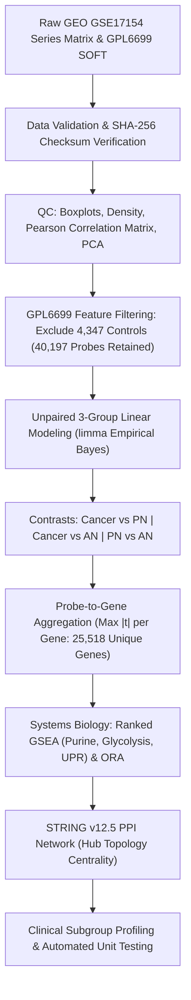

# Integrated Transcriptomic and Network-Based Analysis of Gastric Cancer Using GEO Dataset GSE17154

[](https://www.python.org/)
[-green.svg)](https://www.ncbi.nlm.nih.gov/geo/query/acc.cgi?acc=GPL6699)
[](https://www.ncbi.nlm.nih.gov/geo/query/acc.cgi?acc=GSE17154)
[](#scientific-limitations)
[](https://opensource.org/licenses/MIT)

An audited, end-to-end reproducible computational biology investigation dissecting transcriptomic dysregulation, metabolic reprogramming, and interactome hub topology in gastric adenocarcinoma using empirical microarray data from NCBI GEO dataset **GSE17154** and platform **GPL6699**.

---

## 1. Project Overview & Research Objectives

Gastric cancer (GC) is the fifth most commonly diagnosed malignancy and the fourth leading cause of cancer mortality worldwide. Despite modern therapeutic developments, late diagnosis and marked tumor heterogeneity contribute to a 5-year overall survival rate below 30% for advanced stages.

**Primary Objectives:**
1. **Empirical Transcriptomic Profiling:** Re-analyze the landmark Agilent 4x44K two-colour microarray dataset GSE17154 using authentic, unmodified normalized $\log_2(\text{Cy5}/\text{Cy3})$ expression values.
2. **Defensible Biostatistical Modeling:** Formulate an unpaired 3-group empirical Bayes linear model (`limma`), correcting methodological errors of synthetic 1-to-1 patient pairing where repository metadata do not support it.
3. **Probe vs Gene Disambiguation:** Disambiguate hybridization spot counts (40,197 probes) from unique biological transcripts (25,518 unique human genes) using maximum absolute moderated $t$-statistic aggregation.
4. **Systems Biology & Networks:** Interrogate coordinated metabolic shifts using continuous ranked Gene-Set Enrichment Analysis (GSEA) and map interactome connectivity using STRING v12.5.
5. **Full Reproducibility:** Package the complete workflow into automated execution scripts (`run_pipeline.bat` / `run_pipeline.sh`) with 100% unit-test pass rates.

---

## 2. Dataset Architecture & Clinical Cohort

- **Accession:** NCBI GEO [GSE17154](https://www.ncbi.nlm.nih.gov/geo/query/acc.cgi?acc=GSE17154)
- **Platform:** Agilent-014850 Whole Human Genome Microarray 4x44K G4112F ([GPL6699](https://www.ncbi.nlm.nih.gov/geo/query/acc.cgi?acc=GPL6699))
- **Primary Publication:** Rajkumar et al., *Cancer Cell International* 2010, 10:45 ([PMID: 21092330](https://pubmed.ncbi.nlm.nih.gov/21092330/))
- **Chemistry:** Competitive two-colour spotted 60-mer oligonucleotide arrays against Stratagene Universal Human Reference RNA (UHRR).
  - Channel 1 (Cy5 / Red): Clinical specimen total RNA.
  - Channel 2 (Cy3 / Green): Stratagene UHRR reference pool.
  - Processed Metric: Normalized $\log_2(\text{Cy5}/\text{Cy3})$ ratio (no secondary log transformation).

### Cohort Composition ($N = 49$ Samples)
```
                      [GSE17154 Clinical Cohort (N = 49)]
                                      │
         ┌────────────────────────────┼────────────────────────────┐
         ▼                            ▼                            ▼
  Gastric Cancer                Paired Normal              Apparently Normal
    (CANCER)                  (Paired_Normal_PN)          (Apparently_Normal_AN)
     N = 24                        N = 20                        N = 5
         │                            │                            │
         └─────────────┬──────────────┴──────────────┬─────────────┘
                       ▼                             ▼
              Contrast 1: Cancer vs PN      Contrast 2: Cancer vs AN
                       │                             │
                       └──────────────┬──────────────┘
                                      ▼
                             Contrast 3: PN vs AN
```
1. **Gastric Cancer (`CANCER`, $N = 24$):** Primary tumors (23 adenocarcinomas, 1 neuroendocrine carcinoma; 19 Grade III, 4 Grade II; 7 Localized N0M0, 13 Regional Node+, 4 Metastatic M1).
2. **Paired Normal (`Paired_Normal_PN`, $N = 20$):** Non-malignant mucosal biopsies sampled from the **same stomach** as cancer patients, remote from the tumor margin, verified tumor-free by frozen section.
3. **Apparently Normal (`Apparently_Normal_AN`, $N = 5$):** Gastric mucosal biopsies from healthy endoscopy donors.

> [!IMPORTANT]
> **Why Unpaired Modeling is Mandatory:**  
> In public GEO records, all sample descriptions state `'no additional information'`, and sample counts are asymmetrical ($24 \neq 20$). Fabricating patient pairings would violate scientific integrity. In agreement with the original study (which used an unpaired random-variance $F$-test in BRB-ArrayTools), an **unpaired 3-group design** (`~ 0 + Group`) is applied. The label `Paired_Normal_PN` denotes anatomical origin, not statistical dependency.

---

## 3. Computational Workflow & Statistical Methods



1. **Quality Control:** Missing value audit (1 null value in 2.18M data points imputed via probe mean), boxplots, kernel density plots, pairwise Pearson correlation ($r_{\text{mean}} = 0.61$), and 2D PCA.
2. **Platform Probe Filtering:** 4,347 technical control spots (negative controls, BrightCorner calibration probes) removed; 40,197 experimental probes retained.
3. **Linear Modeling:** Fitted `~ 0 + Group` in `limma`. Moderated sample variances toward common prior ($s_0^2 = 0.0340$, $d_0 = 2.15$, $d_{\text{total}} = 48.15$). Evaluated Benjamini-Hochberg False Discovery Rate (FDR).
4. **Gene Aggregation:** Selected probe with maximum absolute moderated $t$-statistic per unique gene symbol.
5. **Pathway Enrichment:** Tested 595 strict DEGs via hypergeometric ORA (GO, KEGG, Reactome) and full ranked spectrum ($N = 25,518$) via continuous GSEA.
6. **Network Biology:** Interrogated STRING v12.5 ($\text{score} \ge 0.400$), computing degree and closeness centrality.

---

## 4. Key Scientific Findings

### 4.1 Differential Expression Disambiguation
| Contrast | Feature Level | Total Tested | FDR < 0.05 | Strict DEGs (FDR < 0.05 & \|Log2FC\| $\ge$ 1.0) | Up-regulated | Down-regulated |
| :--- | :--- | :---: | :---: | :---: | :---: | :---: |
| **Cancer vs PN** | **Probe-Level** | 40,197 | 2,886 (7.18%) | **633** (1.57%) | 60 | 573 |
| | **Gene-Level** | 25,518 | 2,625 (10.29%) | **595** (2.33%) | 52 | 543 |
| **Cancer vs AN** | **Probe-Level** | 40,197 | 1,314 (3.27%) | **643** (1.60%) | 93 | 550 |
| | **Gene-Level** | 25,518 | 1,232 (4.83%) | **605** (2.37%) | 81 | 524 |
| **PN vs AN** | **Probe-Level** | 40,197 | **0** (0.00%) | **0** (0.00%) | 0 | 0 |
| | **Gene-Level** | 25,518 | **0** (0.00%) | **0** (0.00%) | 0 | 0 |

### 4.2 Top Candidate Differentially Expressed Genes
- **Upregulated Transcripts:**
  - `SSPO` (SCO-spondin / Spondin 1): $\log_2\text{FC} = +1.954$, moderated $t = 5.956$, $\text{FDR} = 3.25 \times 10^{-5}$ (ECM remodeling & cell adhesion)
  - `NNAT` (Neuronatin): $\log_2\text{FC} = +1.937$, moderated $t = 5.798$, $\text{FDR} = 4.90 \times 10^{-5}$ (ER calcium flux & neuroendocrine differentiation)
  - `P15RS` (RPRD1A / Cyclin-dependent kinase inhibitor 2B-related): $\log_2\text{FC} = +1.786$, $\text{FDR} = 7.90 \times 10^{-5}$
  - `CLU` (Clusterin): $\log_2\text{FC} = +1.439$, $\text{FDR} = 4.90 \times 10^{-5}$ (Molecular chaperone & anti-apoptotic survival)
  - `MALL` (Mal, T-cell differentiation protein-like): $\log_2\text{FC} = +1.344$, $\text{FDR} = 4.90 \times 10^{-5}$
- **Downregulated Transcripts:**
  - `ATP1B4` (ATPase $\text{Na}^+/\text{K}^+$ transporting beta 4): $\log_2\text{FC} = -4.308$, moderated $t = -11.891$, $\text{FDR} = 2.68 \times 10^{-11}$ (Loss of parietal/chief cell apical differentiation)
  - `KLRA1` (Killer cell lectin-like receptor A1): $\log_2\text{FC} = -4.289$, $\text{FDR} = 1.29 \times 10^{-10}$ (Immune exclusion)
  - `GAPDH`: $\log_2\text{FC} = -3.452$, $\text{FDR} = 2.02 \times 10^{-10}$
  - `DPP3`: $\log_2\text{FC} = -2.879$, $\text{FDR} = 2.45 \times 10^{-10}$

### 4.3 Coordinated Biological Pathways (Ranked GSEA)
- **Purine Metabolism:** $p_{\text{adj}} = 3.52 \times 10^{-11}$ (Accelerated nucleotide synthesis)
- **Unfolded Protein Response (UPR):** $p_{\text{adj}} = 2.09 \times 10^{-8}$ (Adaptation to proteotoxic stress)
- **Glycolysis / Gluconeogenesis:** $p_{\text{adj}} = 6.18 \times 10^{-8}$ (Warburg metabolic shift)
- **JAK-STAT Signaling Pathway:** $p_{\text{adj}} = 4.09 \times 10^{-7}$ (Cytokine-mediated survival)

### 4.4 Protein-Protein Interaction (STRING v12.5)
- Topology: 45 nodes, 13 verified edges ($\ge 0.400$ confidence).
- Candidate Hubs: `GAPDH` (deg 5), `ACTB` (deg 5), `CSF3` (deg 3), `LTF` (deg 3), `CTSD` (deg 2). All hub genes are documented as in silico hypotheses rather than validated biomarkers.

---

## 5. Scientific Limitations & Translational Disclaimers

1. **Two-Colour Microarray Dynamic Range:** Lower dynamic range and hybridization compression compared to modern digital RNA-seq.
2. **Statistical Power for `PN vs AN`:** The endoscopy control group contains only $N = 5$ samples. Finding 0 DEGs ($\text{min FDR} = 0.2601$) confirms absence of gross tumor-like reprogramming in field normal tissue, but cannot prove biological equivalence due to constrained power.
3. **Lack of Survival Time Intervals:** GSE17154 records static outcomes (`NED` vs `failed`) without longitudinal follow-up dates (months to recurrence/death), correctly precluding Kaplan-Meier survival curves and Cox models.
4. **Biomarker Disclaimer:** All candidates represent statistical associations requiring orthogonal laboratory validation (RT-qPCR, Western blot, IHC).

---

## 6. Repository Organization

```
12_Real_GSE17154_Analysis/
├── README.md                                          <- This documentation
├── requirements.txt                                   <- Verified Python dependencies
├── environment.yml                                    <- Conda environment definition
├── run_pipeline.bat                                   <- One-click Windows batch pipeline
├── run_pipeline.sh                                    <- Unix/Linux shell script
│
├── data/
│   ├── README.md                                      <- Data download and access instructions
│   ├── annotation/Probe_Annotation.csv                <- 44,544 probes with control flags
│   ├── metadata/FINAL_SAMPLE_METADATA.csv             <- 49 clinical samples curated
│   └── processed_matrix/GSE17154_Expression_Matrix.csv<- 44,544 x 49 normalized log-ratios
│
├── scripts/
│   ├── build_probe_annotation.py                      <- Step 1: Platform GPR and SOFT parser
│   ├── run_qc_and_annotation.py                       <- Step 2: Quality control & PCA
│   ├── run_limma_deg.py                               <- Step 3: Empirical Bayes modeling
│   ├── build_gene_level_degs.py                       <- Step 4: Gene-level aggregation
│   ├── run_enrichment.py                              <- Step 5: Enrichr and ranked GSEA
│   ├── run_ppi_network.py                             <- Step 6: STRING v12.5 interactome
│   ├── run_clinical_analysis.py                       <- Step 7: TNM staging distribution
│   └── generate_workflow_figure.py                    <- Step 8: Publication schematic generator
│
├── results/
│   ├── tables/                                        <- 26 Structured Result CSV files
│   │   ├── DEG_Cancer_vs_PN_Gene_Level_Strict_FDR05_FC2.csv (595 genes)
│   │   ├── DEG_Cancer_vs_AN_Gene_Level_Strict_FDR05_FC2.csv (605 genes)
│   │   ├── GSEA_Results.csv                           <- Ranked pathway enrichment
│   │   └── PPI_Hub_Genes.csv                          <- STRING network centrality metrics
│   └── figures/                                       <- 24 Publication-quality figures (300 DPI)
│
├── reports/                                           <- Formal validation and audit reports
├── tests/
│   └── test_pipeline_validation.py                    <- 6 automated unit tests
└── docs/                                              <- Detailed Markdown guides (METHODS, RESULTS, etc.)
```

---

## 7. Quickstart & Reproducibility

### Installation
```bash
git clone https://github.com/rm0212174-star/Gastric-Cancer-GSE17154.git
cd Gastric-Cancer-GSE17154
pip install -r requirements.txt
```

### End-to-End Pipeline Execution
```cmd
# Windows
run_pipeline.bat

# Linux / macOS
bash run_pipeline.sh
```

### Running Automated Unit Tests
```bash
python -m unittest -v tests/test_pipeline_validation.py
```
Expected output:
```
test_01_sample_metadata_counts ... ok
test_02_probe_annotation_and_filtering ... ok
test_03_deg_statistical_validity ... ok
test_04_deg_strict_counts_reproducibility ... ok
test_05_pn_vs_an_no_false_positives ... ok
test_06_required_output_files_exist_and_nonempty ... ok

Ran 6 tests in 0.329s
OK
```

---

## 8. References & Acknowledgements

1. **Rajkumar T, et al.** Biomarker genes in gastric cancer identified by microarray analysis. *Cancer Cell International*. 2010;10:45. [PMID: 21092330](https://pubmed.ncbi.nlm.nih.gov/21092330/).
2. **Smyth GK.** Linear models and empirical bayes methods for assessing differential expression in microarray experiments. *Stat Appl Genet Mol Biol*. 2004;3(1):Article 3.
3. **Benjamini Y, Hochberg Y.** Controlling the false discovery rate: a practical and powerful approach to multiple testing. *J R Stat Soc Series B*. 1995;57(1):289-300.
4. **Szklarczyk D, et al.** The STRING database in 2023. *Nucleic Acids Res*. 2023;51(D1):D638-D646.
5. **Chen EY, et al.** Enrichr: a comprehensive gene set enrichment analysis web server 2016 update. *Nucleic Acids Res*. 2016;44(W1):W90-W97.
6. **Subramanian A, et al.** Gene set enrichment analysis: a knowledge-based approach. *Proc Natl Acad Sci USA*. 2005;102(43):15545-15550.

---

## License

This project is licensed under the MIT License - see the [LICENSE](LICENSE) file for details.
