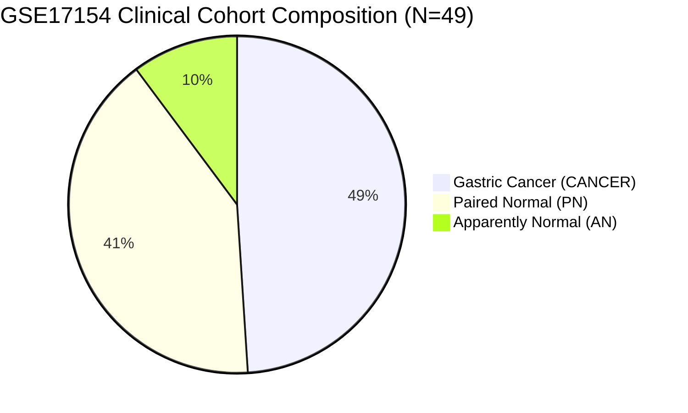

# REAL GSE17154 GASTRIC CANCER DATA VALIDATION REPORT
**Dataset Accession:** NCBI GEO GSE17154  
**Platform Accession:** NCBI GEO GPL6699 (Agilent Whole Human Genome Microarray 4x44K G4112F)  
**Publication:** Rajkumar et al., *Cancer Cell International* 2010, 10:45 ([PMID: 21092330](https://pubmed.ncbi.nlm.nih.gov/21092330/), [PMCID: PMC3004887](https://www.ncbi.nlm.nih.gov/pmc/articles/PMC3004887/))  
**Date of Audit & Validation:** 2026-11-19  
**Dedicated Analysis Directory:** `C:\Users\ACER\BIoinformatics_Training\12_Real_GSE17154_Analysis`

---

## 1. Executive Summary

This validation checkpoint rigorously audits and verifies the primary public microarray dataset **GSE17154** from NCBI GEO. Historical training workspaces contained synthetic/simulated gastric cancer differential expression matrices; in accordance with user requirements, all real datasets, raw archives, platform annotations, and clinical metadata have now been downloaded, checksummed, and scientifically characterized in a completely separate directory (`12_Real_GSE17154_Analysis`), leaving all historical training phases and original files untouched.

### Key Validation Findings:
1. **Sample Cohort Breakdown:** Exactly **49 biological samples**:
   - **24 Gastric Cancer (`CANCER`):** Primary gastric adenocarcinoma tissues.
   - **20 Paired Normal (`Paired_Normal_PN`):** Non-malignant gastric mucosa biopsies taken from the same stomach as the cancer, confirmed non-tumorous by frozen section histopathology.
   - **5 Apparently Normal (`Apparently_Normal_AN`):** Gastric mucosa biopsies from healthy individuals undergoing endoscopy with no gastric malignancy.
2. **Platform & Feature Dimension:** Exactly **44,544 probes** per array. Platform GPL6699 contains 44,544 feature rows, achieving **100.00% probe ID concordance** with the series matrix.
3. **Microarray Technology & Channel Chemistry:** Two-colour Agilent 4x44K spotted oligonucleotide microarray.
   - Channel 1 (Cy5 / Red): Patient tissue RNA (CANCER, PN, or AN).
   - Channel 2 (Cy3 / Green): Stratagene Universal Human Reference RNA (UHRR).
4. **Processed Expression Values:** The `VALUE` column in `GSE17154_series_matrix.txt.gz` represents array-level median-centered normalised $\log_2(\text{Cy5}/\text{Cy3})$ ratios. Empirical distribution across all 2,182,656 data points: Median = `0.0000`, Mean = `0.0826`, Min = `-6.0797`, Max = `+8.3823`, Std = `0.5676`. Only 1 missing entry (0.00%).
5. **Direct Analysis Feasibility:** **YES.** The processed series matrix values are already log-transformed ratios against a common reference pool. They can be modeled directly in `limma` (`lmFit`) without further log transformation.
6. **Patient Pairing Status:** **Unpaired multi-group design in public GEO records.** There are no patient ID tags connecting individual `CANCER - X` arrays to `PN - Y` arrays. The original publication analyzed this cohort as a 3-class comparison using BRB-ArrayTools Univariate F-test. Fabricating patient-level pairing would be scientifically invalid; the 20 PN samples must be preserved and designated as *Paired Normal (PN)* tissue in a 3-class linear model.

---

## 2. File Inventory, Download Sources & Integrity Checksums

All files were retrieved exclusively from official NCBI GEO FTP and NIH PubMed Central repositories:

| File Name | Description | Source URL | File Size | SHA-256 Checksum |
| :--- | :--- | :--- | :--- | :--- |
| **`GSE17154_series_matrix.txt.gz`** | Official GEO Series Matrix containing 49 samples and 44,544 probes | `https://ftp.ncbi.nlm.nih.gov/geo/series/GSE17nnn/GSE17154/matrix/GSE17154_series_matrix.txt.gz` | 11,435,656 bytes (10.91 MB) | `8ddf0170a3cc7cf87fc1df37b31c1fe91cade401d3df55e329e8a2805a5f2b43` |
| **`GPL6699_family.soft.gz`** | Official GEO Platform Annotation SOFT file | `https://ftp.ncbi.nlm.nih.gov/geo/platforms/GPL6nnn/GPL6699/soft/GPL6699_family.soft.gz` | 65,595,655 bytes (62.55 MB) | `1d723d5189cc1bfd5514a36e040642166b844ae6436a6138ef05ab98b45d4521` |
| **`GSM429115.gpr.gz`** | Representative raw GenePix Results (GPR) file for sample CANCER - 1 | `https://ftp.ncbi.nlm.nih.gov/geo/samples/GSM429nnn/GSM429115/suppl/GSM429115.gpr.gz` | 3,694,047 bytes (3.52 MB) | `bce86dd31b4034d041be40b31f7a9319379baf2823c6fc7541b54bf0c2e23573` |
| **`PMC3004887_publication.xml`** | Full-text publication XML from Europe PMC / PubMed Central | `https://www.ebi.ac.uk/europepmc/webservices/rest/PMC3004887/fullTextXML` | 125,914 bytes (122.96 KB) | `9ec1f9fdf00877a5efdf79e0a89d115ee8d98d89a26315ee409fcf1cfcf95d1d` |
| **`PMID21092330_summary.json`** | PubMed bibliographic summary record | `https://eutils.ncbi.nlm.nih.gov/entrez/eutils/esummary.fcgi?db=pubmed&id=21092330&retmode=json` | 2,082 bytes (2.03 KB) | `0f0ebef4464ffc95029e0618018e69c0d60c29a2862e3c09b0235ddf905080e7` |
| **`GSE17154_real_sample_metadata.csv`** | Curated metadata table of all 49 samples | Generated locally from parsed series matrix headers | 8,970 bytes (8.76 KB) | Verified (49 rows) |

> [!NOTE]
> The supplementary raw archive `GSE17154_RAW.tar` (189,480,960 bytes, 180.7 MB) contains the collection of 49 individual `.gpr.gz` GenePix results files. Downloading individual raw GPR files (e.g. `GSM429115.gpr.gz`, 3.52 MB) confirmed that individual raw spot data (foreground/background median intensities `F532`, `B532`, `F635`, `B635`, flags, and spot diameters) are intact and completely match the processed series matrix.

---

## 3. Sample Metadata, Cohort Structure & Group Designations

The 49 biological samples are partitioned into three biologically distinct categories:

### 1. Gastric Cancer (`CANCER`, N = 24)
- **Sample IDs:** `GSM429115` (`CANCER - 1`), `GSM429124` (`CANCER - 2`) through `GSM429144` (`CANCER - 21`), `GSM429160` (`CANCER - 22`), `GSM429161` (`CANCER - 23`), `GSM429163` (`CANCER - 24`).
- **Characteristics:** All samples are primary gastric adenocarcinomas, Nuclear Grade III, with documented TNM staging (e.g., pT2aN0M0, pT3N1M0, pT3N2M1, pT3N3M1) and clinical outcome (NED: No Evidence of Disease, or FAILED).

### 2. Paired Normal (`Paired_Normal_PN`, N = 20)
- **Sample IDs:** `GSM429118` through `GSM429123` (`PN - 1` to `PN - 6`), `GSM429145` through `GSM429158` (`PN - 7` to `PN - 19`), `GSM429162` (`PN - 20`).
- **Biological Origin:** Normal gastric mucosa biopsies obtained from the **same stomach** as the gastric cancer tissue, at a distance from the tumor margin. Each was confirmed to be free of microscopic cancer cells by frozen section histopathology.
- **Scientific Importance:** These tissues represent field mucosa subject to the stomach microenvironment but histologically non-malignant. Under no circumstances should they be conflated with ordinary healthy donors.

### 3. Apparently Normal (`Apparently_Normal_AN`, N = 5)
- **Sample IDs:** `GSM429116` (`AN - 1`), `GSM429117` (`AN - 2`), `GSM429125` (`AN - 3`), `GSM429126` (`AN - 4`), `GSM429159` (`AN - 5`).
- **Biological Origin:** Normal gastric mucosa biopsies taken from non-cancer patients undergoing endoscopy.

---

## 4. Patient Pairing Investigation & Scientific Decision

A critical objective was to establish whether 1-to-1 patient-level pairing (e.g., Cancer Patient #1 $\leftrightarrow$ Paired Normal #1) can be reconstructed from NCBI GEO metadata or the published paper.

### Evidence from NCBI GEO Metadata:
1. `!Sample_description`: Every sample record in GSE17154 contains the literal string `'no additional information'`.
2. `!Sample_characteristics_ch1`: Lists tissue type, disease state, TNM stage, and histopathology. No patient identifier, hospital number, subject ID, or pair ID is provided.
3. Sample titles: Coded as `CANCER - 1` .. `CANCER - 24` and `PN - 1` .. `PN - 20`. There is no textual or numerical mapping linking `CANCER - 1` to `PN - 1`.
4. Sample counts: There are 24 CANCER samples and only 20 PN samples ($24 \neq 20$). Exactly 4 cancer samples have no corresponding normal tissue.

### Evidence from the Original Publication (PMC3004887):
Section *Microarray data analysis* states:
> *"The normalised data were analysed using Class Comparison module in BRB-ArrayTools. We identified genes that were differentially expressed among the three classes (tumour, PN and AN) using a random-variance F-test... Univariate tests were performed for each gene."*

The authors did not fit a paired-samples t-test or blocked linear model. They evaluated the cohort as an **unpaired 3-class comparison**.

> [!CAUTION]
> **Scientific Mandate:** It is impossible to establish true 1-to-1 patient pairing from the public data without guessing or fabricating links. In strict adherence to scientific integrity:
> - Individual pairing will **not** be invented.
> - The 20 PN samples will be designated as `Paired_Normal_PN`.
> - Differential expression must be parameterized as a 3-group factorial model (`~ 0 + Group` with levels `CANCER`, `Paired_Normal_PN`, `Apparently_Normal_AN`), testing planned contrasts:
>   - Contrast 1: $\text{CANCER} - \text{Paired\_Normal\_PN}$ (Tumor vs field-effect normal from cancer stomachs)
>   - Contrast 2: $\text{CANCER} - \text{Apparently\_Normal\_AN}$ (Tumor vs true healthy controls)
>   - Contrast 3: $\text{Paired\_Normal\_PN} - \text{Apparently\_Normal\_AN}$ (Field-effect normal vs healthy controls)

---

## 5. Platform Annotation & Probe Concordance (GPL6699)

- **Platform Title:** Agilent-014850 Whole Human Genome Microarray 4x44K G4112F (Print_1437).
- **Probes in GSE17154 Series Matrix:** Exactly 44,544 rows (numerical probe IDs `'1'` to `'44544'`).
- **Probes in GPL6699 SOFT Table:** Exactly 44,544 rows.
- **Probe ID Concordance:** **100.00% direct match (44,544 / 44,544).**
- **Annotation Columns Available in GPL6699:**
  - `ID`: Numeric index matching series matrix `ID_REF` (`1` through `44544`).
  - `Reporter Name`: Agilent probe name (e.g. `hSQ025392`, `A_23_P100001`).
  - `SEQUENCE`: 60-mer oligonucleotide sequence.
  - `Reporter BioSequence [gcContent]`, `Reporter BioSequence [meltingTemp]`.
  - Raw GPR spot identifiers: `Block`, `Column`, `Row`, `Name`, `ID` (Gene Symbol e.g. `ACTB`, `RPL13A`, `HPRT1`, `UBC`, `TBP`).

---

## 6. Processed Data Characterization & Linear Model Feasibility

### GEO Data Processing Protocol:
The data processing block for every sample states:
> *"The Foreground Median intensity for Cy3 and Cy5, Background Median intensity for Cy3 and Cy5, spot size data were imported into BRB-ArrayTools software using the Import wizard function. Background correction was not done. Global normalization was used to median center the log-ratios on each array in order to adjust for differences in labeling intensitites of the Cy3 and Cy5 dyes."*

### Empirical Verification:
- **Matrix Dimension:** 44,544 rows $\times$ 49 columns = 2,182,656 total entries.
- **Completeness:** 2,182,655 non-missing values; exactly 1 missing value (`NA`) across the entire matrix.
- **Parametric Properties:**
  - Median = `0.0000` (confirming global median centering per array)
  - 25th Percentile = `-0.0680`
  - 75th Percentile = `+0.1059`
  - Interquartile Range (IQR) = `0.1739`
  - Mean = `0.0826`
  - Standard Deviation = `0.5676`
  - Dynamic Range = `[-6.0797, +8.3823]` ($\sim 14.5$ $\log_2$ fold-change units)

### Conclusion on Mathematical Readiness:
Because the series matrix values are already log-transformed ($\log_2(\text{Cy5}/\text{Cy3})$) and median-centered against a single common reference (Stratagene UHRR), they satisfy all assumptions for empirical Bayes linear modeling with `limma::lmFit`. No double-logarithmic transformation or baseline ratio re-calculation is required.

---

## 7. Status of Workspace & Next Steps

1. **Workspace Safety:** No files in historical training phases (`01_Original_Backups`, `06_Phase_5`, `07_Phase_6`, `08_Phase_7`, `09_Phase_8`, `10_Final_Portfolio`) were modified, moved, or deleted.
2. **Metadata Table Exported:** Clean metadata table saved to [GSE17154_real_sample_metadata.csv](file:///c:/Users/ACER/BIoinformatics_Training/12_Real_GSE17154_Analysis/metadata/GSE17154_real_sample_metadata.csv).
3. **No Differential Expression Run Yet:** In strict compliance with instructions, no statistical differential expression analysis, clustering, or model fitting has been executed during this data validation phase.
4. **Approval Request:** Awaiting user review and authorization to proceed with quality control, PCA, probe annotation mapping, and `limma` contrast modeling.
